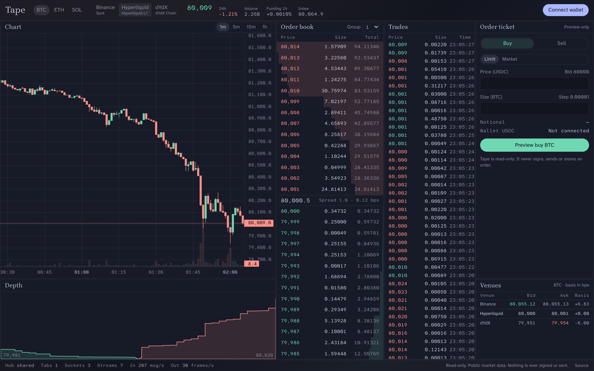

# Tape

Live order books for Binance's USDT spot pairs and the perps Hyperliquid, dYdX and Orderly list, Hyperliquid's USDC HIP-3 dexes included, with order entry on Hyperliquid's main dex, dYdX and Orderly. Orderly's Community Listed markets and markets whose tick needs more than 8 decimals, such as dYdX PEPE-USD, stay out. Built with TanStack Start on TanStack Redact.

Demo: [tape.kegler.dev](https://tape.kegler.dev) reads mainnet. [tape.testnet.kegler.dev](https://tape.testnet.kegler.dev) trades on testnet.



The screen has an order book with price grouping, a trade feed, a depth chart, candles, a venues table with best bid, best ask and basis, and an order ticket that validates price and size against each venue's tick and step. A wallet connects and shows USDC on Ethereum, Arbitrum, Base and Optimism. On Hyperliquid, dYdX and Orderly the ticket sends orders, and an Account panel shows positions, orders and fills. On Hyperliquid it also deposits USDC from Arbitrum, Base, OP Mainnet or Ethereum. Binance stays read only. A History page reads every fill and funding payment those three venues still serve, totals realized PnL, fees and funding, and exports a CSV.

## Six decisions

### 1. One WebSocket per venue, shared across tabs

A SharedWorker hub owns the sockets. Each tab sends its full want set, for example "the BTC book on Binance grouped by 1". The hub derives the streams it needs from all tabs, counts references, and keeps a stream for 10 s after the last tab lets go, so switching BTC to ETH and back skips a resync.

SharedWorker ports never fire a close event. Each tab holds a Web Lock named after its id, and the hub asks for the same lock. The browser grants it when the tab dies, and the hub drops that tab's wants. `pagehide` sends a goodbye as the fast path.

Reconnects go through a pure state machine in `src/hub/connection.ts`: backoff with jitter, a silence watchdog, keepalive and resubscribe. A venue that accepts the socket and drops it at once keeps backing off, and a book that keeps failing to parse waits out a doubling hold instead of resubscribing in a loop. The status bar shows the hub's own numbers. Open a second tab and it reads `Tabs 2 · Sockets 4`.

Chrome Android has no SharedWorker. There each tab runs the same hub in a dedicated worker, so you get one socket per venue per tab. `?hub=dedicated` forces that mode anywhere.

### 2. Order book render without jank

The hub does the work off the main thread: book sync, grouping, formatting, cumulative totals and depth bar ratios. It ships render-ready frames to each tab at most every 100 ms, throttled with TanStack Pacer. Hidden tabs get no frames.

The tab keeps only the latest frame per topic and flushes once per animation frame inside a TanStack Store batch. The book has 28 fixed rows keyed by index, so DOM nodes never move. Each row subscribes to its own slice with a shallow compare. The depth bar is a `scaleX` transform, the depth chart is a canvas, and candles go straight to `series.update`. None of those three render React.

Measured in headless Chrome on 2026-10-28, 20 s per market:

| Market | Venue messages in | Book flushes | Rows touched per flush | Long tasks |
| --- | --- | --- | --- | --- |
| Binance BTC | 564/s | 176 | 25 of 28 | 0 |
| dYdX ETH | 333/s | 163 | 27 of 28 | 0 |

In a busy book most rows change every flush, because a new level shifts every cumulative total below it. The win is the cap on how often the DOM is touched, not skipping rows.

### 3. Decimals, not floats

Prices and sizes parse into safe integers at each market's scale, branded as `Px` and `Qty` in `packages/core/src/fixed.ts`. The parser rejects digits beyond the scale and values past `Number.MAX_SAFE_INTEGER` instead of rounding. Notional and spread run in `bigint`. Tick and step checks in the ticket are integer modulo.

Floats exist only in display data: chart coordinates, depth bar ratios, the basis column, candle history and the 24h stats line in the header. Prices in the book, the trade feed, the ticket and the venues table are exact, and best bid and ask across venues compare rescaled integers. Inside the data path, `toDisplayFloat` is the one exit.

Integers instead of `bigint` everywhere keep book levels fast as `Map` keys and in sorts. A BTC price at 8 decimals is about 8e12, far from the safe limit.

### 4. One model for three protocols

| Venue | Market | Book feed | What it needs |
| --- | --- | --- | --- |
| Binance | spot | REST snapshot plus sequenced diffs | Buffer diffs, fetch the snapshot after the first diff, replay, refetch on a gap |
| Hyperliquid | perps | Full 20-level snapshot every message | Tick is 5 significant figures, so it depends on the price |
| dYdX v4 | perps | Snapshot on subscribe, then deltas | The indexer book can cross, so a fresher write evicts the stale side, and a corrupt book resubscribes |
| Orderly | perps | Full snapshot every second | Numbers come as JSON numbers, so they are read from the source text, not as doubles |

Each venue is one adapter behind `VenueAdapter` in `packages/venues/src/types.ts`: market rules, subscribe frames, a parser from raw messages to one event type, 24h stats and candle history. Everything after the parser is venue-agnostic. One pure function, `stepBook` in `packages/core/src/book.ts`, runs all three book protocols. A new venue is one adapter file plus recorded fixtures.

The tests replay frames recorded from each venue in `packages/venues/src/__fixtures__` until each book is live and uncrossed. `pnpm fixtures` records fresh ones from mainnet, and `NETWORK=testnet pnpm fixtures` from testnet.

### 5. Orders signed in the browser, judged by the venue

Tape has no server between the user and the venue. Each trading venue is one module behind `TradingVenue` in `packages/trade/src/types.ts`: setup steps, enable, account reads, commands and an order lookup.

| Venue | Setup | Signing |
| --- | --- | --- |
| Hyperliquid | The wallet approves an agent key, plus a builder fee when one is configured | The agent signs msgpack actions. The key stays on the device |
| dYdX v4 | The wallet signs dYdX's onboarding message, and the dYdX key derives from it | The key lives in the tab only, since it can withdraw |
| Orderly | The wallet registers the account and adds an ed25519 key | The key signs each request |

Every send gets a new client id and nothing resends on its own. A send with no answer is an unknown outcome: the ticket says so, asks the venue for that client id, and tells whether the order is there. A rejection always shows the venue's own words.

Deposits leave from the wallet itself. `Deposit` in the Account panel moves USDC to Hyperliquid perps: from Arbitrum through Hyperliquid's bridge, free and credited in about a minute, or on mainnet from Base, OP Mainnet and Ethereum over Circle's CCTP, which burns the USDC and has Circle forward it to the same address on Hyperliquid for a fee Circle quotes. Before the wallet signs, the dialog shows the route, fee, gas, time and each transaction the wallet will ask for. It blocks an amount under the bridge's 5 USDC minimum, which Hyperliquid keeps without crediting, a USDC or gas shortfall, a contract wallet, and a transaction the chain would revert. After the send it follows the deposit to the credit in Hyperliquid's ledger and keeps the receipt on the device. Each venue's routes sit behind `DepositVenue` in `packages/trade/src/deposit.ts`.

Each build is one network, set by `VITE_NETWORK`. A `testnet` build reads books, trades and candles from the testnets and trades there too, so the price on screen is the price the order meets. The default `mainnet` build only reads: the ticket validates and sends nothing unless the build also sets `VITE_TRADE_MAINNET=1`. `VITE_TESTNET_SITE` links the mainnet site to the testnet one. `VITE_WALLETCONNECT_PROJECT_ID`, a [Reown](https://cloud.reown.com) project id, adds a WalletConnect button that shows a QR for a phone wallet. Without it the build offers only the browser's own wallet.

The production server sends a Content Security Policy with a nonce per request. Only scripts the server rendered run, and the page connects only to its own network's hosts, listed in `src/csp.ts`, plus Circle's API for CCTP fees and status on mainnet. A new venue host goes there, and `src/csp.test.ts` fails until it does. `pnpm dev` sends no policy, because Vite's dev client injects inline scripts.

Analytics run no third-party script. The page queues events from a fixed list in `src/analytics/events.ts` and sends them with `sendBeacon` to `/r1` on its own origin. The server validates the batch and forwards it to PostHog's batch API with `POSTHOG_KEY`, and `POSTHOG_HOST` (default EU cloud). Events make no person profile and carry no wallet address. Each is keyed by a page load id that lives in memory and tagged with the build's network. The visitor's IP goes along for GeoIP, unless the PostHog project discards it. Without `POSTHOG_KEY` the route drops everything.

Errors take the same route to PostHog error tracking. The page sends uncaught errors, unhandled rejections, route errors, unexpected trade failures and errors in the hub worker as `$exception`, each with its stack and a message cleared of addresses and keys. An uncaught error with no frame on the site's own origin, like one from a wallet extension, stays on the page. Each JS context sends an error once, and 10 at most. When the build has `POSTHOG_PERSONAL_API_KEY`, a personal key that can write error tracking, and `POSTHOG_PROJECT_ID`, it marks each browser chunk with an id, uploads the source maps to `POSTHOG_HOST` (default US cloud) as release `tape` at `GITHUB_SHA`, and deletes them. A failed upload fails the build. Without both variables the build has no source maps.

### 6. History that adds up to the venue's number

Each trading venue also reads its full history from a public endpoint, with no key: Hyperliquid's `userFillsByTime` and `userFunding`, dYdX's indexer `fills` and `fundingPayments`, and Orderly's public query. History is only reads, so it works on the read-only mainnet site and for any address pasted in.

Realized PnL per fill is the venue's own figure where it reports one, Hyperliquid's `closedPnl` and Orderly's `realized_pnl`. dYdX reports none, so `realize` in `packages/trade/src/history.ts` computes it by average cost: increases average the entry, reductions realize against it, and a flip closes everything before it opens the rest. Amounts are `bigint` at 18 places, so sums of venue decimals are exact. Fees and funding stay apart from realized PnL, and net is realized minus fees plus funding.

The tests replay recorded history of public mainnet accounts in `packages/trade/src/__fixtures__` and check the result against each venue's own numbers: average cost reproduces Hyperliquid's `closedPnl` on every fill of one account and Orderly's `realized_pnl` on every fill of another. The net lands within cents of Hyperliquid's perp PnL chart, which samples every 15 minutes and rounds to cents, and on dYdX's `totalPnl` to the micro dollar. `pnpm fixtures:history` records fresh ones. The CSV columns are under [History CSV](#history-csv).

## Stack

- TanStack Start on TanStack Redact, the alternative React runtime
- Nitro's `cloudflare-module` preset, one Cloudflare Worker per network
- TanStack Router with typed params and validated search, Query for market rules, stats and candle history, Store, Pacer, Virtual for the trade feed, Form for the ticket, Table v9 for the venues table
- wagmi and viem for the wallet, the dYdX client for its chain, msgpack and noble curves for Hyperliquid and Orderly signing
- lightweight-charts for candles
- Tailwind 4, TypeScript strict with `noUncheckedIndexedAccess`, Vitest

## Limits

- Chrome Android falls back to one socket per venue per tab.
- Tab death through Web Locks is verified in Chrome. Safari and Firefox support Web Locks, but this path is not tested there yet.
- Hyperliquid sends 20 levels per side, so wide grouping shows fewer rows.
- The ticket checks tick and step, not each venue's minimum order value.
- Market data comes from public endpoints. Binance comes from the `data-api.binance.vision` mirrors.
- Trading was verified on testnets with an unfunded wallet, so the proof is each venue naming the signer it recovered. Orderly orders past registration and mainnet are not verified.
- No take profit or stop loss on dYdX and Orderly, and no leverage change on dYdX.
- Deposits go to Hyperliquid only. Tape never sent one in verification: the proof is the transaction the wallet was asked for, and real deposits by other wallets replayed through the receipt.
- Deposit gas shows in the chain's native token, without USD.
- History has no deposits, withdrawals, transfers or vaults. Hyperliquid serves only its 10,000 most recent fills, dYdX's indexer pages through 25,000 fills, and only dYdX subaccount 0 is read.

## History CSV

`/history` exports what the filters show: one row per fill and one per funding payment, oldest first. The file is RFC 4180 with CRLF line ends, UTF-8, and a header row. Columns keep their names and order. A new column goes at the end.

Amounts are exact decimals with a dot and no grouping, as the venue sent them, except `notional` and a computed `realized_pnl`. An empty cell means the column does not apply to that row.

| Column | Fill | Funding |
| --- | --- | --- |
| `time_utc` | ISO 8601 in UTC, to the millisecond | same |
| `timestamp_ms` | Unix time in milliseconds | same |
| `venue` | `hyperliquid`, `dydx` or `orderly` | same |
| `network` | `mainnet` or `testnet` | same |
| `account` | The venue account: the wallet on Hyperliquid, the `dydx1` address on dYdX, the account id on Orderly | same |
| `type` | `fill` | `funding` |
| `market` | The venue's symbol, like `BTC`, `BTC-USD` or `PERP_BTC_USDC` | same |
| `side` | `buy` or `sell` | empty |
| `size` | Filled size, always positive | Position size when funding settled, negative for a short |
| `price` | Fill price | empty |
| `notional` | `price` × `size`, exact | empty |
| `fee` | Positive is paid, negative is a rebate | empty |
| `asset` | What the fee and the PnL settle in, usually `USDC` | What the payment settles in |
| `realized_pnl` | PnL this fill realized, before fees and funding. `0` on a fill that opens or adds | empty |
| `realized_pnl_source` | `venue` when the venue reports it, `computed` when Tape computed it by average cost | empty |
| `funding` | empty | Positive is received, negative is paid |
| `funding_rate` | empty | The rate the venue applied |
| `liquidation` | `true` when the venue closed the position: a liquidation, or a deleverage on dYdX | empty |
| `venue_id` | The venue's id for the fill | empty |

Net PnL over a period is the sum of `realized_pnl`, minus the sum of `fee`, plus the sum of `funding`, per `asset`.

### Per venue

- Hyperliquid reports `realized_pnl` on each fill. It serves only its 10,000 most recent fills, so an account with a long history starts partway, and `/history` says so. Spot fills are left out.
- dYdX reports no PnL per fill. Tape computes it by average cost from the first fill, rounded to 6 decimals. Subaccount 0 only. The indexer pages through 25,000 fills at most.
- Orderly reports `realized_pnl` on each fill. One address can hold an account per broker, and each one is its own `account`. Funding still accruing is left out until it settles.

Deposits, withdrawals, transfers and vault flows are not in the file.

## Run it

```bash
pnpm install
pnpm dev
```

```bash
VITE_NETWORK=testnet pnpm dev
```

```bash
pnpm verify   # package boundaries, typecheck of each package and the app, no notes in the public repo, import cycles, lint, format, unused code, tests
pnpm verify:commits # pnpm verify on each commit since origin/main, as the pre-push hook and CI run it
pnpm build
pnpm fixtures # re-record venue fixtures
pnpm fixtures:history # re-record trade history fixtures
node scripts/capture.mjs # screenshot and social preview from a running preview server
```

`pnpm preview` serves the last build with `wrangler dev`, in workerd, the runtime Cloudflare runs.

## Deploy

Mainnet is the Worker `tape` and testnet is `tape-testnet`. A push to `main` that passes `verify` and `e2e` runs the `deploy` job in `.github/workflows/verify.yml`, which builds each network and runs `wrangler deploy` with `CLOUDFLARE_API_TOKEN` and `CLOUDFLARE_ACCOUNT_ID`. The build reads every `VITE_` variable of the GitHub environment named after the network. The Worker reads `POSTHOG_KEY` and `POSTHOG_HOST` from its own variables in Cloudflare, which a deploy keeps.

## Layout

A pnpm workspace. The app sits at the root and imports three packages through `workspace:*`. The packages ship TypeScript source with no build step, so Vite and Vitest read them like app code and HMR reaches them.

```
packages/core     @tape/core: ids, fixed point, market rules, book sync
packages/venues   @tape/venues: one market data adapter per venue, plus recorded fixtures
packages/trade    @tape/trade: one trading module per venue behind TradingVenue
src/core          the hub protocol: topics, frames, projections
src/hub           the worker: sockets, connection state machine, projections
src/client        the tab side: hub connection, store registry, hooks
src/trade         React hooks, key storage and env config for @tape/trade
src/ui            screen components
src/wallet        wagmi config and the wallet button
```

Packages never import React or the app. `scripts/check-packages.mjs` runs first in `pnpm verify` and fails on an import a package does not declare, an import of `#/`, or a cycle between packages. A package reads no env: the app passes `TradeConfig` in the venue context.

To add a package, create `packages/<name>` with a `package.json` named `@tape/<name>` (`private: true`, `exports` pointing at `src`), a `tsconfig.json` that extends `../../tsconfig.base.json`, and add its `tsc -p` to the `typecheck` script.
