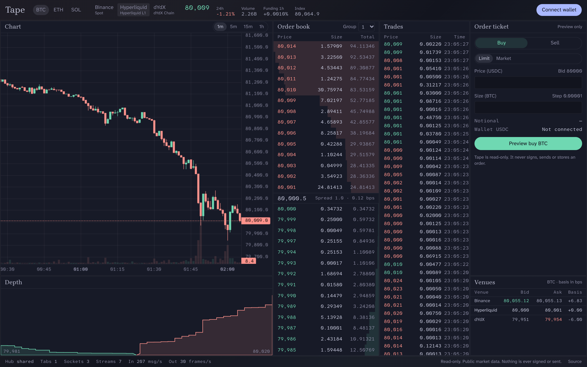

# Tape

Live order books for Binance's USDT spot pairs and the perps Hyperliquid, dYdX and Orderly list, Hyperliquid's USDC HIP-3 dexes included, with order entry on Hyperliquid's main dex, dYdX and Orderly. Orderly's Community Listed markets and markets whose tick or step needs more than 8 decimals, such as dYdX PEPE-USD, stay out. Built with TanStack Start on TanStack Redact.

Demo: [tape.kegler.dev](https://tape.kegler.dev) reads mainnet. [tape.testnet.kegler.dev](https://tape.testnet.kegler.dev) trades on testnet.



The screen has an order book with price grouping, a trade feed, a depth chart, candles, a venues table with best bid, best ask and basis, and an order ticket that validates price and size against each venue's tick and step. A wallet connects and shows USDC on Ethereum, Arbitrum, Base and Optimism. On Hyperliquid, dYdX and Orderly the ticket sends orders, and an Account panel shows positions, orders and fills. It deposits USDC to Hyperliquid from Arbitrum, Base, OP Mainnet or Ethereum, and to Orderly from Arbitrum, Base or OP Mainnet. Binance stays read only. A History page reads every fill and funding payment those three venues still serve, totals realized PnL, fees and funding, and exports a CSV.

See [How Tape works](docs/architecture.md) for the design and the stack.

## Limits

- Chrome Android falls back to one socket per venue per tab.
- Tab death through Web Locks is verified in Chrome. Safari and Firefox support Web Locks, but this path is not tested there yet.
- Hyperliquid sends 20 levels per side, so wide grouping shows fewer rows.
- The ticket refuses an order worth less than the venue minimum on Hyperliquid and Orderly, each scale leg too. Reduce-only orders, closes of a whole position and TP/SL legs go to the venue unchecked.
- Market data comes from public endpoints. Binance comes from the `data-api.binance.vision` mirrors.
- Trading was verified on testnets with an unfunded wallet, so the proof is each venue naming the signer it recovered. Orderly orders past registration and mainnet are not verified.
- No take profit or stop loss on dYdX and Orderly, and no leverage change on dYdX.
- Deposits go to Hyperliquid and Orderly only. Tape never sent one in verification: the proof is the transaction the wallet was asked for, and real Hyperliquid deposits by other wallets replayed through the receipt. Following an Orderly credit needs the depositor's own key, so it was checked only against the reply in Orderly's docs.
- Deposit gas shows in the chain's native token, without USD.
- History has no deposits, withdrawals, transfers or vaults. Hyperliquid serves only its 10,000 most recent fills, dYdX's indexer pages through 25,000 fills, and only dYdX subaccount 0 is read.

The History export is specified in [History CSV](docs/history-csv.md).

## Run it

```bash
pnpm install
pnpm dev
```

```bash
VITE_NETWORK=testnet pnpm dev
```

```bash
pnpm verify   # package boundaries, typecheck of each package and the app, no notes in the public repo, import cycles, lint, format, unused code, tests
pnpm verify --docs # only the format check and check-public, what a markdown-only change runs
pnpm verify:commits # pnpm verify on each commit since origin/main, as the pre-push hook and CI run it, or pnpm verify --docs on a markdown-only commit
pnpm e2e # Playwright journeys on the testnet and mainnet production builds over the recorded replay, with all outside network blocked
pnpm build
pnpm fixtures # re-record venue fixtures
pnpm fixtures:history # re-record trade history fixtures
RECORD_WRITES=dydx pnpm fixtures:writes # re-record one venue's testnet write replies, Hyperliquid also takes RECORD_WRITES_HL_KEY_FILE
node scripts/capture.mjs # screenshot and social preview from a running preview server
```

Every night `.github/workflows/nightly.yml` records each venue on mainnet and testnet and replays it through the parsers, opens the testnet build against the live venues, and runs `pnpm e2e` in Firefox and WebKit.

`pnpm preview` serves the last build with `wrangler dev`, in workerd, the runtime Cloudflare runs.

Deploys and build variables are in [Deploy](docs/deploy.md).

## Layout

A pnpm workspace. The app sits at the root and imports three packages through `workspace:*`. The packages ship TypeScript source with no build step, so Vite and Vitest read them like app code and HMR reaches them.

```
packages/core     @tape/core: ids, fixed point, market rules, book sync
packages/venues   @tape/venues: one market data adapter per venue, plus recorded fixtures
packages/trade    @tape/trade: one trading module per venue behind TradingVenue
src/core          the hub protocol: topics, frames, projections
src/hub           the worker: sockets, connection state machine, projections
src/client        the tab side: hub connection, store registry, hooks
src/trade         React hooks, key storage and env config for @tape/trade
src/ui            screen components
src/wallet        wagmi config and the wallet button
```

Packages never import React or the app. `scripts/check-packages.mjs` runs first in `pnpm verify` and fails on an import a package does not declare, an import of `#/`, or a cycle between packages. A package reads no env: the app passes `TradeConfig` in the venue context.

To add a package, create `packages/<name>` with a `package.json` named `@tape/<name>` (`private: true`, `exports` pointing at `src`), a `tsconfig.json` that extends `../../tsconfig.base.json`, and add its `tsc -p` to the `typecheck` script.
